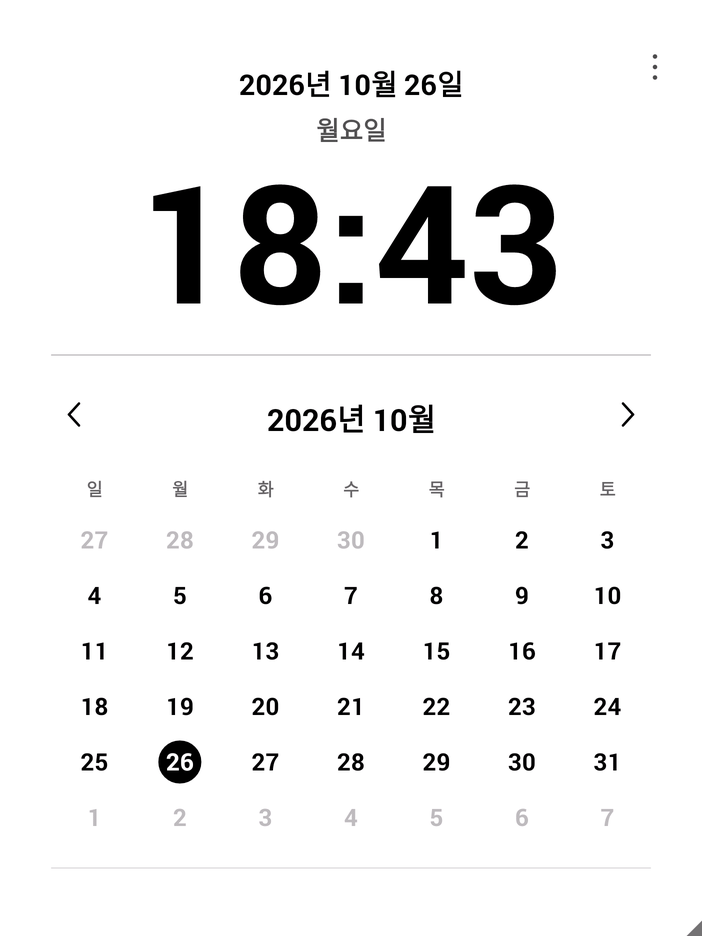

# paperclock · 페이퍼 시계·달력

리디 페이퍼 프로를 탁상 시계와 월간 달력으로 사용하는 Android 앱입니다. 날짜·요일·큰 디지털 시계·월간 달력을 한 화면에 표시하며, 와이파이가 연결되면 시간을 자동으로 맞춥니다.

Android 4.4.2의 리디 페이퍼 프로에서 실제 동작을 확인했습니다. 현재 버전은 **1.2**입니다.



## 주요 기능

- 전자잉크 화면에 맞춘 흰 배경과 굵은 글씨
- 한국 날짜·요일과 24시간 형식의 시계
- 월간 달력과 오늘 날짜 강조
- 이전 달·다음 달 이동, 이번 달로 돌아오기
- 일요일 또는 월요일부터 한 주 시작
- 1분마다 화면 갱신, 초 표시와 애니메이션 생략
- 조명 기본 꺼짐, 메뉴에서 켜기·끄기
- 앱 실행 및 와이파이 재연결 시 인터넷 시간 자동 맞춤
- 앱을 켜둔 동안 6시간마다 시간 재보정
- 인터넷이 끊겨도 마지막으로 보정한 시간을 이어서 표시
- 인터넷이 없는 환경을 위한 수동 날짜·시간 설정

루팅이나 Google 계정이 필요하지 않습니다. 광고나 별도 서버도 사용하지 않습니다.

## 설치와 실행

[설치용 APK 다운로드](https://github.com/jawoongku/paperclock/releases/latest/download/paper-clock.apk) · [릴리스 목록](https://github.com/jawoongku/paperclock/releases) · [SHA-256 확인값](dist/paper-clock.apk.sha256)

APK를 기기에 복사해서 열어 설치하거나, USB 디버깅을 켠 뒤 ADB로 설치할 수 있습니다. ADB를 이용할 때는 다음과 같이 실행합니다.

```bash
git clone https://github.com/jawoongku/paperclock.git
cd paperclock

adb devices
adb install -r dist/paper-clock.apk
adb shell am start -n local.paperclock/.MainActivity
```

기기에 USB 디버깅 허용 창이 나타나면 연결을 승인합니다. 이후에는 USB 연결 없이 기기에서 앱을 실행할 수 있습니다.

### 앱 다시 열기

기기의 런처 또는 앱 목록에서 **페이퍼 시계·달력**을 누릅니다. E-Ink Launcher에서도 같은 이름으로 표시됩니다.

컴퓨터에 연결돼 있다면 아래 명령으로도 실행할 수 있습니다.

```bash
adb shell am start -n local.paperclock/.MainActivity
```

단순히 잠든 상태라면 전원 버튼을 짧게 눌러 돌아올 수 있습니다. 기기를 완전히 재부팅한 뒤에는 앱을 다시 열어야 합니다.

## 화면 조작

| 조작 | 동작 |
| --- | --- |
| 달력 왼쪽·오른쪽 화살표 | 이전 달·다음 달로 이동 |
| 달력의 연·월 제목 | 이번 달로 돌아오기 |
| 오른쪽 위 `⋮` 또는 화면 길게 누르기 | 설정 메뉴 열기 |
| 전원 버튼 짧게 누르기 | 기기 슬립 상태로 전환하거나 깨우기 |

설정 메뉴에서는 다음 항목을 사용할 수 있습니다.

- 오늘로 돌아가기
- 날짜·시간 맞추기
- 조명 켜기·끄기
- 일요일·월요일 시작 전환
- 인터넷 시간으로 지금 맞추기
- 앱 닫기

## 자동 시간 맞춤

인터넷에 연결되면 Google Public NTP의 `time.google.com`에서 시간을 받아 **Asia/Seoul** 기준으로 표시합니다. 첫 서버에 접속하지 못하면 `time2.google.com`, `time3.google.com`을 차례로 시도합니다.

앱 실행과 와이파이 재연결 시 자동으로 맞추고, 앱을 계속 켜두면 6시간 간격으로 다시 보정합니다. 통신에 실패하면 기존 시각을 유지하면서 재시도 간격을 늘립니다. 메뉴의 **인터넷 시간으로 지금 맞추기**를 눌러 직접 요청할 수도 있습니다.

기기 전체의 시스템 시계를 변경하지 않고 앱의 표시 시간을 보정합니다. 보정한 UTC 시각과 기기의 경과 시간(`elapsedRealtime`)을 함께 저장하므로, 같은 부팅 상태에서는 앱을 다시 실행하거나 잠들었다 깨어나도 시간이 이어집니다.

와이파이가 없는 상태에서 재부팅했다면 메뉴에서 날짜·시간을 확인해 주세요. 다시 인터넷에 연결되면 자동으로 보정합니다. NTP 통신에는 UDP 123번 포트를 사용합니다.

앱이 요청하는 권한은 두 가지입니다.

| 권한 | 용도 |
| --- | --- |
| `INTERNET` | 시간 서버에 접속 |
| `ACCESS_NETWORK_STATE` | 인터넷 연결과 재연결 확인 |

## 전원 동작

이 앱은 **기기를 깨어 있게 유지하면서** 시계와 달력을 갱신합니다. 조명은 기본적으로 꺼두지만, 기기의 원래 슬립 모드와 전력 사용량은 다릅니다. 배터리 지속 시간은 아직 측정하지 않았습니다.

전원 버튼을 누르면 리디 펌웨어가 관리하는 슬립 화면으로 전환됩니다. 완전한 슬립 상태에서 시계를 계속 갱신하는 기능은 포함하지 않습니다. 앱을 닫으면 앱이 지정했던 조명 밝기 제한도 해제됩니다.

## 소스에서 빌드하기

Gradle이나 외부 Android 라이브러리 없이 Android SDK 도구로 빌드합니다.

검증한 빌드 환경은 다음과 같습니다.

- macOS Apple Silicon
- Python 3.9 이상
- JDK 17
- Android SDK Platform 19
- Android SDK Build-Tools 37.0.0

Android SDK Manager에서 필요한 패키지를 설치합니다.

```bash
sdkmanager "platforms;android-19" "build-tools;37.0.0"
```

JDK와 SDK 설치 경로를 지정하고 빌드합니다. 아래 macOS 예시의 SDK 경로는 설치 위치에 맞게 수정합니다.

```bash
export JAVA_HOME="$(/usr/libexec/java_home -v 17)"
export ANDROID_HOME="$HOME/Library/Android/sdk"

python3 build_app.py
```

`ANDROID_HOME` 대신 `ANDROID_SDK_ROOT`도 사용할 수 있습니다. 기존 개발 환경의 `tools/` 아래에 JDK와 SDK를 풀어둔 경우에는 그 경로를 대체 경로로 사용합니다. SDK와 JDK 자체는 저장소에 포함하지 않습니다.

빌드 과정에서 달력 계산과 NTP 통신 테스트를 실행하고 APK 서명을 검사합니다. NTP 테스트는 로컬 UDP 서버를 사용하므로 외부 시간 서버나 연결된 기기가 필요하지 않습니다.

완성된 파일은 `dist/paper-clock.apk`입니다.

### 서명 키

첫 빌드에서는 로컬 개발용 서명 키를 `build/paperclock.keystore`에 생성합니다. 이 키는 Git에 포함하지 않습니다. 직접 빌드한 앱을 계속 업데이트하려면 같은 키를 보관해서 사용해야 합니다. 새로 생성한 키로 서명한 APK는 저장소에 제공된 APK와 서명이 다릅니다.

## ADB 보조 도구

Python 보조 도구는 기본적으로 ADB에 연결된 기기 한 대를 사용합니다. 여러 기기가 연결돼 있다면 `ADB_SERIAL`에 사용할 기기 번호를 지정합니다.

```bash
python3 ridi_control.py clock   # 앱 실행
python3 ridi_control.py sleep   # 기기 슬립
python3 ridi_control.py wake    # 기기 깨우기
python3 ridi_control.py status  # 기기 상태 확인

ADB_SERIAL="기기번호" python3 ridi_control.py clock
```

와이파이가 없는 경우 컴퓨터의 현재 시각으로 앱 시간을 맞출 수도 있습니다.

```bash
python3 start_paper_clock.py
```

리디 펌웨어의 정적 슬립 이미지를 선택하는 보조 기능도 있습니다. 이 기능은 앱의 시계 화면과 별개로 동작합니다.

```bash
python3 ridi_control.py image /path/to/image.png
```

## 검증

자동 빌드 테스트에서 요일·윤년·월 경계, 시간 경과 계산, NTP 응답 검증, 잘못된 기기 날짜, 2036년 NTP 타임스탬프 순환, 재시도 정책, UDP 통신과 응답 시간 제한을 확인합니다.

리디 페이퍼 프로 실기기에서는 다음 항목을 확인했습니다.

- 날짜·요일·시계·월간 달력 표시와 분 단위 자동 갱신
- 달력 이동, 한 주 시작 요일 변경, 조명 전환
- 날짜·시간 설정 취소
- 앱 종료 후 재실행과 슬립 후 복귀
- 와이파이 연결 시 직접 NTP 동기화
- 와이파이 연결 해제 후 시간 유지와 재연결 시 자동 동기화

화면 조작 검증을 다시 실행하려면 앱을 열고 조명을 끈 상태, 일요일 시작으로 설정한 뒤 아래 명령을 실행합니다. 이 도구는 1404×1872 세로 화면의 리디 페이퍼 프로를 기준으로 작성됐으며, 기기 조작과 앱 재실행·슬립 시험을 수행합니다.

```bash
python3 verify_device.py
```

검증 로그와 캡처는 로컬 `evidence/`에 저장되며 Git에 포함하지 않습니다.

## 저장소 구성

```text
app/
  AndroidManifest.xml
  src/local/paperclock/    # 시계·달력 화면, 시간 계산, NTP 클라이언트
  tests/                  # JVM에서 실행하는 달력·통신 테스트
docs/images/              # 앱 화면 예시
dist/                     # 설치용 APK와 SHA-256
build_app.py              # 컴파일·테스트·서명
ridi_control.py           # ADB 실행·전원·슬립 이미지 보조 도구
start_paper_clock.py      # 컴퓨터 시간으로 앱 시간 보정
verify_device.py          # 실기기 화면 조작 검증
```

리디 페이퍼 프로 외 기기에서는 동작을 확인하지 않았습니다. 화면은 세로 방향으로 표시하며, 기본 배치인 1404×1872를 화면 크기에 맞춰 비율을 유지해 조정합니다.

## 라이선스

이 프로젝트의 소스 코드와 문서, 배포 APK는 [MIT 라이선스](LICENSE)로 제공합니다.

- 누구나 개인·상업적 목적으로 사용하고 수정할 수 있습니다.
- 원본이나 수정본을 복사·재배포하거나 판매할 수 있습니다.
- 수정한 소스 코드를 공개할 의무는 없습니다.
- 소프트웨어를 복사하거나 재배포할 때 저작권 고지와 MIT 라이선스 고지를 유지해야 합니다.
- 소프트웨어는 보증 없이 제공되며, 라이선스 원문에 보증 부인과 책임 제한 조항이 포함돼 있습니다.

정식 조건은 저장소의 [LICENSE](LICENSE) 원문을 참고하세요. 같은 원문을 배포 APK의 `assets/LICENSE.txt`와 GitHub 릴리스 첨부 파일에도 포함합니다.
